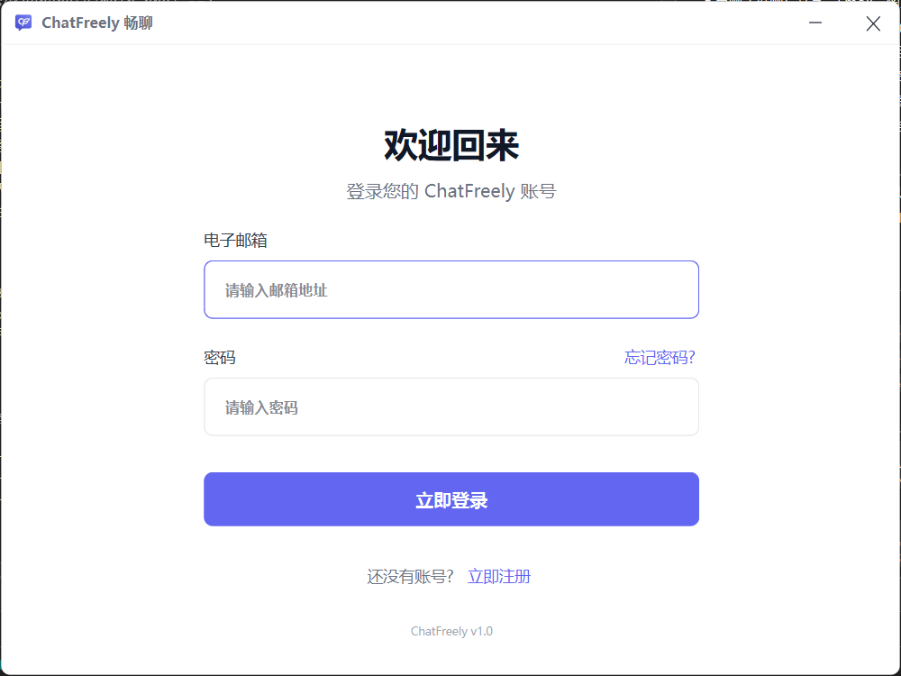

# 畅聊 ChatFreely

基于 Qt 6 + C++17 的桌面即时通讯客户端，支持文字、图片、文件与视频消息。

> 可搭配官方服务端使用（[GitHub](https://github.com/saltedfish3/ChatFreely_Server) ·
> [Gitee](https://gitee.com/saltedfish_mjc/chat-freely_-server)），
> 也可连接自行搭建的兼容服务端。服务器地址在编译时配置，详见「配置服务器地址」。



## 功能特性

- 账号：注册、登录、AccessToken 自动续期、断线自动重连
- 单聊 / 群聊：文字、Emoji、图片、文件、视频消息
- 媒体：图片预览、视频播放器（进度条、倍速）、大文件下载
- 联系人：好友申请与审核、分组、备注、搜索
- 群组：创建群、成员管理、群资料设置
- 本地存储：SQLite 聊天记录、图片缓存、下载文件管理
- 界面：无边框自绘标题栏、自定义窗口按钮、消息列表虚拟化渲染、Toast 提示

## 系统要求

- 运行：Windows 10 1809 及以上 / Windows 11（x64）
- 编译：Visual Studio 2022（MSVC x64）+ Qt 6.10.2 msvc2022_64（含 Qt Multimedia）+ CMake ≥ 3.16
- 目前仅验证 Windows 平台

## 下载

| 平台 | 地址 |
|---|---|
| GitHub Releases | https://github.com/saltedfish3/ChatFreely_Client/releases |
| Gitee Releases | https://gitee.com/saltedfish_mjc/chat-app/releases |

每个版本提供以下文件：

- `ChatFreely-1.0.0-win64-setup.exe`：安装版（推荐）
- `ChatFreely-1.0.0-win64-portable.zip`：便携版，解压即用
- `ChatFreely-1.0.0-source.zip`：对应版本的源码快照

> 两个平台的安装包内容一致，任选其一即可。Gitee 单个附件上限 100MB，安装包体积较大时以 GitHub 为准。

## 从源码构建

```bat
cmake -S . -B build -G Ninja -DCMAKE_BUILD_TYPE=Release ^
      -DCMAKE_PREFIX_PATH=D:/Qt/6.10.2/msvc2022_64
cmake --build build --parallel
```

产物为 `build\ChatClient.exe`。如需可分发目录：

```bat
mkdir dist
copy build\ChatClient.exe dist\
D:\Qt\6.10.2\msvc2022_64\bin\windeployqt.exe --release --dir dist dist\ChatClient.exe
```

## 配置服务器地址

客户端不内置任何服务器地址，连接哪个服务端完全由编译时的配置决定。
使用官方服务端或自建服务端，都只需修改 `CMakeLists.txt` 第 128-135 行后重新编译：

```cmake
# 远程配置接口，留空则不请求
set(CHATFREELY_BOOTSTRAP_URL "https://你的配置接口")
# 兜底服务器地址（配置接口不可用时使用）
set(CHATFREELY_DEFAULT_HOST "你的域名或 IP")
set(CHATFREELY_DEFAULT_TCP_PORT "你的服务器tcp兜底端口")
set(CHATFREELY_DEFAULT_HTTP_PORT "你的服务器http兜底端口")
```

两种配置方式二选一：

| 方式 | 写法 | 适用场景 |
|---|---|---|
| 动态下发 | 填 `CHATFREELY_BOOTSTRAP_URL`，Host / 端口留空 | 服务器地址可能变更；接口需返回 `serverHost`、`tcpPort`、`httpPort`、`useHttps` |
| 固定地址 | `CHATFREELY_BOOTSTRAP_URL` 留空，直接填 Host / 端口 | 地址固定，无配置接口 |

生效优先级为**远端下发 > 本地缓存 > 编译期默认值**，按字段独立降级。

## 数据目录

| 内容 | 路径 |
|---|---|
| 配置 | 注册表 `HKEY_CURRENT_USER\Software\ProChat\ChatFreely` |
| 聊天记录 | `%LOCALAPPDATA%\ProChat\ChatFreely\record\<用户ID>\chat.db` |
| 图片缓存 | `%LOCALAPPDATA%\ProChat\ChatFreely\cache\images` |
| 下载文件 | 系统下载目录 |

## 项目结构

```
src/
├── main.cpp        程序入口
├── network/        TCP 长连接、HTTP 短连接、远程配置
├── chat/           会话、消息、会话管理器
├── database/       SQLite 封装
├── utils/          全局配置、用户信息、好友/群组/图片缓存/视频工具
├── widgets/        界面组件（登录、主窗口、聊天、联系人、群组、设置等）
└── resources/      图片资源（qrc）
```

## 已知限制

- 仅提供 Windows 客户端发布包，其他平台未适配
- 视频播放依赖 FFmpeg；H.264/AAC 相关专利授权不在本项目与 Qt 许可范围内
- 服务端若使用自签证书，需自行处理客户端的证书校验

## 贡献

欢迎提交 Issue 与 PR。提交前请确保代码可编译，风格与现有代码保持一致。

## 许可证

本项目代码采用 **GNU GPL v3**，详见 [LICENSE](LICENSE)。

客户端发行版包含 **Qt 6.10.2**（LGPLv3）与 **FFmpeg**（LGPLv2.1+）等第三方组件，
许可文本与声明见发行包内 `licenses/` 目录。Qt 源码可从
<https://download.qt.io/official_releases/qt/6.10/6.10.2/submodules/> 获取。